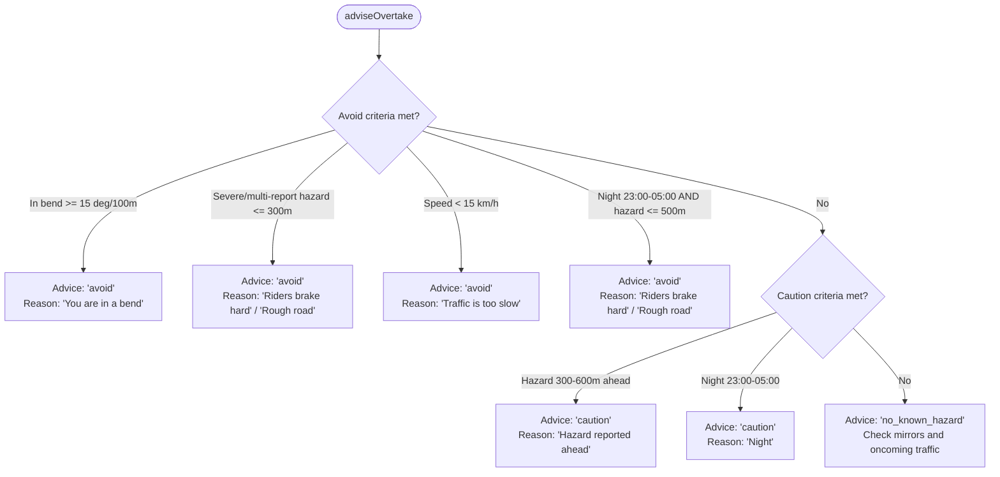

# Overtake Advisor v1 (DRV-12a)

**Owner:** Drive thread ("Honda and Maruti research")  
**Implementation:** `src/lib/overtake-advisor.js`  
**Wired into:** `src/lib/ride-guard.js`  

---

## 1. What It Knows and Cannot Know

### What it knows
1. **Own hazard map**: The community crowd-sourced hazard spots (`hard_brake`, `pothole`, `swerve`) fetched by `ride-guard.js` from `/api/ride/hazards-near`.
2. **Own GPS track**: The last 20 seconds of high-fidelity GPS fixes (`lat`, `lng`, `headingDeg`, `at`), allowing measurement of road curvature (degrees of heading change per 100 metres) directly from vehicle movement.
3. **Vehicle speed**: Current speed in km/h from GPS.
4. **Time of day**: Local clock determining night conditions (23:00 to 05:00).

### What it CANNOT know (Crucial Safety Limits)
1. **No camera**: Cannot see oncoming vehicles, lane markings, blind crests, or pedestrians.
2. **No live traffic feed**: Does not know whether a vehicle is ahead or beside the car.
3. **No map geometry provider yet**: No map data on physical road bends, solid white lines, bridges, or official no-overtaking zones until the Mappls provider is integrated in a subsequent release.
4. **Safety Wording Rule**: The system **never claims the road is clear**. It **never says "clear"**, **never says "safe to overtake"**, and **never says "you can overtake"**. It only reports whether known hazard spots or road bends are detected ahead, reminding the driver to check mirrors and oncoming traffic.

---

## 2. Thresholds and Rationale

| Parameter | Threshold | Why |
| :--- | :--- | :--- |
| `HEADING_TOLERANCE_DEG` | ±30° | Only hazards directly ahead along the line of travel are relevant. Spots behind or on perpendicular roads are ignored. |
| `CURVATURE_BEND_DEG_PER_100M` | 15° / 100 m | A road turning 15° or more across 100 metres represents a significant bend with reduced forward sight distance. |
| `FIXES_WINDOW_MS` | 20,000 ms (20 s) | Sufficient window to compute stable heading change across 100–300 m at normal driving speeds without stale history. |
| `AVOID_HAZARD_DISTANCE_M` | 300 m | Severe braking or rough spots within 300 m require immediate driver attention; overtaking into them is dangerous. |
| `AVOID_HAZARD_SEVERITY_MIN` | Severity ≥ 2 or Reports ≥ 3 | Filters out one-off or minor sensor noise; only confirmed risky road hazards trigger an avoid advisory. |
| `AVOID_MIN_SPEED_KMH` | 15 km/h | Crawling traffic (< 15 km/h) indicates congestion, traffic lights, or urban jams where overtaking is inappropriate. |
| `AVOID_NIGHT_HAZARD_DISTANCE_M` | 500 m | At night (23:00–05:00), visibility is degraded and headlights only illuminate ~100–150 m. Known hazards within 500 m trigger avoid. |
| `CAUTION_HAZARD_DISTANCE_MAX_M` | 600 m | Known hazards between 300 m and 600 m ahead provide early situational awareness. |
| `WATCHER_MIN_SPEED_KMH` | 40 km/h | Unprompted warnings only fire at cruising speeds (≥ 40 km/h) where overtaking manoeuvres typically occur. |
| `WATCHER_COOLDOWN_MS` | 3 minutes (180 s) | Prevents nagging and voice fatigue. |
| `WATCHER_SPEECH_QUIET_MS` | 2 minutes (120 s) | Never speaks within 2 minutes of any other voice prompt (hazard warnings, stay awake nudges, crash check-ins). |
| `WATCHER_MAX_PER_HOUR` | 6 warnings / hour | Maximum ceiling on unprompted spoken advisories per hour. |

---

## 3. Decision Matrix (`adviseOvertake`)

---

## 4. Spoken Lines (Multilingual)

### English (en)
- **Avoid:** `"Don't overtake here. {reason}."`  
  *(Reasons: "You are in a bend", "Riders brake hard just ahead", "Rough road just ahead", "Traffic is too slow")*
- **Caution:** `"Be careful. Something is reported about {n} metres ahead. Check your mirrors and oncoming traffic."`
- **Caution (Night without hazard):** `"Be careful. It is night. Check your mirrors and oncoming traffic."`
- **No Known Hazard:** `"Nothing is reported for the next {n} metres. Check your mirrors and oncoming traffic before you overtake."`

### Hindi (hi)
- **Avoid:** `"यहाँ ओवरटेक न करें। {reason}।"`  
  *(Reasons: "आगे मोड़ है", "आगे अचानक ब्रेक लगते हैं", "आगे खराब सड़क है", "ट्रैफिक बहुत धीमा है")*
- **Caution:** `"सावधान रहें। आगे लगभग {n} मीटर पर कुछ रिपोर्ट हुआ है। अपने शीशे और सामने का ट्रैफिक देखें।"`
- **Caution (Night without hazard):** `"सावधान रहें। रात का समय है। अपने शीशे और सामने का ट्रैफिक देखें।"`
- **No Known Hazard:** `"अगले {n} मीटर तक कुछ भी रिपोर्ट नहीं है। ओवरटेक करने से पहले अपने शीशे और सामने का ट्रैफिक देखें।"`

### Telugu (te)
- **Avoid:** `"ఇక్కడ ఓవర్‌టేక్ చేయవద్దు. {reason}."`  
  *(Reasons: "ముందు మలుపు ఉంది", "ముందు వాహనాలు హఠాత్తుగా బ్రేక్ వేస్తాయి", "ముందు రోడ్డు బాగాలేదు", "ట్రాఫిక్ చాలా నెమ్మదిగా ఉంది")*
- **Caution:** `"జాగ్రత్త. ముందు దాదాపు {n} మీటర్లలో ఏదో రిపోర్ట్ అయింది. మీ అద్దాలు మరియు ఎదురుగా వచ్చే ట్రాఫిక్ చూడండి."`
- **Caution (Night without hazard):** `"జాగ్రత్త. రాత్రి సమయం. మీ అద్దాలు మరియు ఎదురుగా వచ్చే ట్రాఫిక్ చూడండి."`
- **No Known Hazard:** `"తదుపరి {n} మీటర్ల వరకు ఏమీ రిపోర్ట్ కాలేదు. ఓవర్‌టేక్ చేసే ముందు మీ అద్దాలు మరియు ఎదురుగా వచ్చే ట్రాఫిక్ చూడండి."`

---

## 5. Unprompted Watcher (`createOvertakeWatcher`)

Runs automatically in the background via `ride-guard.js`:
- Only gives an unprompted warning for `avoid` triggered by a **bend** or a **road hazard**.
- Speed must be **≥ 40 km/h**.
- At most **once per 3 minutes**.
- Stays silent if other speech occurred in the last **2 minutes**.
- Maximum **6 unprompted warnings per hour**.

---

## 6. NOTE for Intent Layer Thread

> [!NOTE]
> When implementing voice intent `OVERTAKE_CHECK` ("can I overtake?", "क्या मैं ओवरटेक कर सकता हूँ?", "నేను ఓవర్‌టేక్ చేయవచ్చా?"):
> - Wire the voice handler to call `adviseOvertake({ position, speedKmh, provider, fixes, now, lang })`.
> - Do **NOT** edit routing files or voice intent files from this Drive thread.
